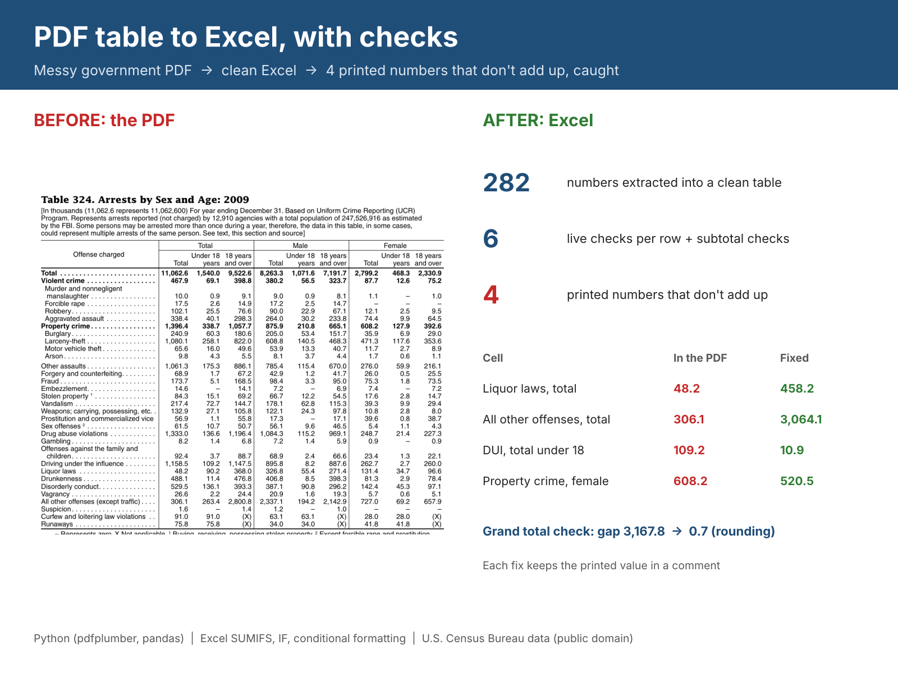

# PDF table to Excel, with automatic checks

Clients send PDFs and need the numbers in Excel, correct. This sample turns a messy government PDF table into a clean Excel workbook and **checks every row with live formulas**. The checks caught **4 printed numbers that don't add up** in the source PDF.



## The PDF
U.S. Census Bureau, *Statistical Abstract of the United States: 2012*, Table 324 "Arrests by Sex and Age: 2009" (public domain, U.S. Government work; original source FBI Uniform Crime Reports). Two header levels, dot leaders, wrapped labels, footnote markers, `–` and `(X)` symbols, and a second table on the same page. Copy used: tabula-java test files.

## What was done
1. Read every character with its position (`pdfplumber`), group characters into lines and assign numbers to the 9 columns by their right edge.
2. Join wrapped labels, strip dot leaders, move footnote markers to a Note column, mark subtotals and their components.
3. Convert `–` (represents zero) to 0 and `(X)` (not applicable) to blank; keep values in thousands as printed.
4. Run 6 arithmetic checks per row (Total = Male + Female, Total = Under 18 + 18 and over, …) plus subtotal and grand-total checks, all as Excel formulas.
5. Recompute only the cells that fail by a wide margin, keep the printed value in a cell comment, and confirm the grand total now adds up.

## Result
| | |
|---|---|
| Rows / numbers extracted | 32 / 282 |
| Rows passing all checks | 24 |
| Small gaps (a dash hiding a small value, or rounding) | 4 rows |
| Printed values that don't add up (fixed) | 4 cells |
| Grand total check, largest gap | 3,167.8 before → 0.7 after (rounding) |

| Cell | In the PDF | Fixed | How |
|---|---|---|---|
| Liquor laws, total | 48.2 | 458.2 | Male + Female |
| All other offenses, total | 306.1 | 3,064.1 | Male + Female |
| Driving under the influence, total under 18 | 109.2 | 10.9 | Male + Female under 18 |
| Property crime, female | 608.2 | 520.5 | Under 18 + 18 and over |

## Files
- `PDF_Table_to_Excel_with_Checks.xlsx`: Summary, Checks, Clean Table (as printed), Corrected Table, Long Format (ready for pivot tables), Source & Method
- `extract_table.py`: PDF → clean CSV (pdfplumber + pandas)
- `build_xlsx.py`: builds the Excel file with the check formulas
- `src/12s0324.pdf`: the source PDF

## Run it
```bash
pip install pdfplumber pandas openpyxl
python extract_table.py src/12s0324.pdf out
python build_xlsx.py
```
